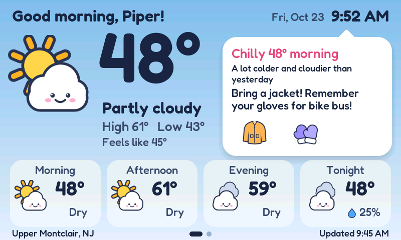
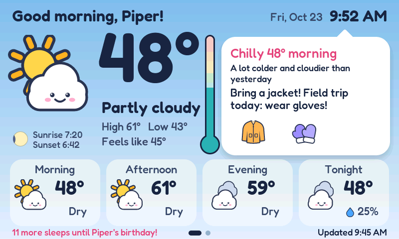
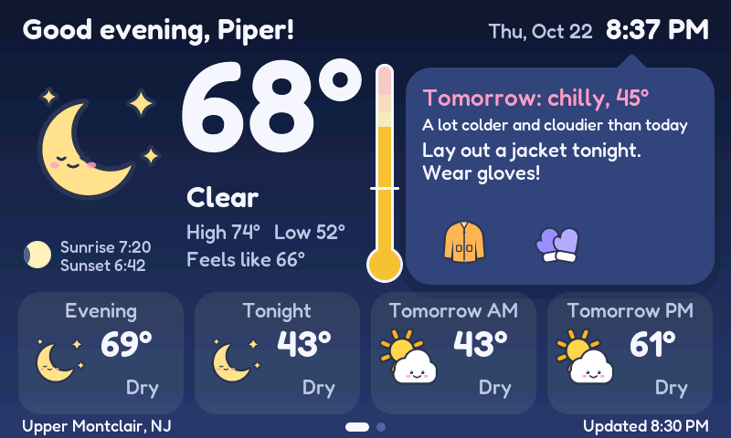
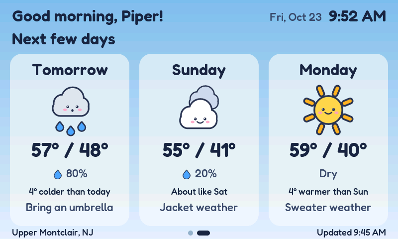
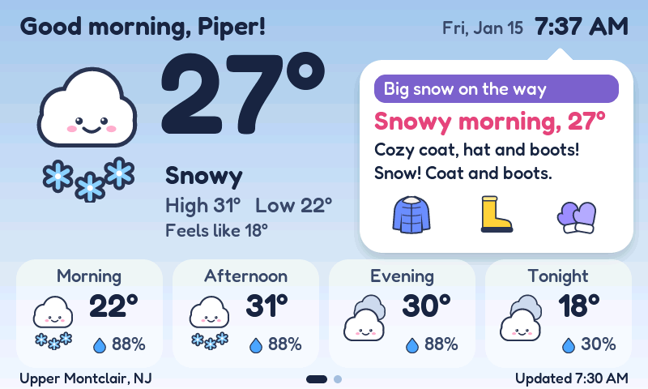
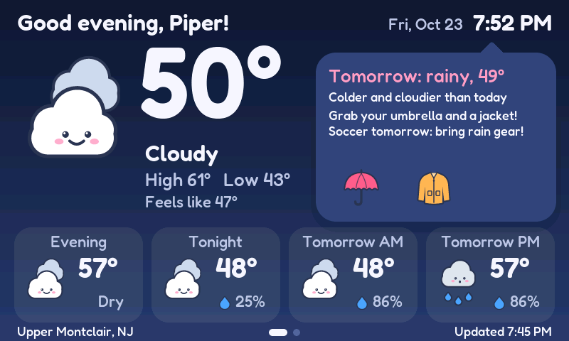
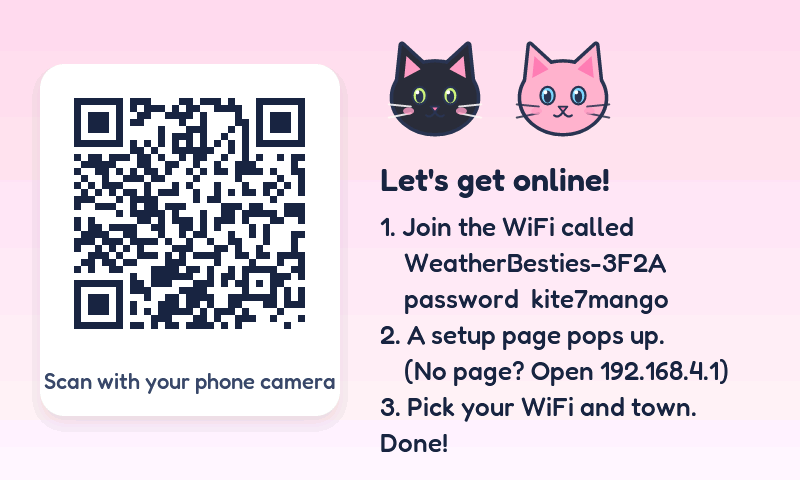

# Weather Besties

A weather station for Piper, made for the two moments that decide what to wear: **bedtime and wake-up**.

Built on the Waveshare ESP32-S3-Touch-LCD-4.3 (800 x 480 touch screen), it lets her check the night before, lay out the right clothes, then wake up and see at a glance whether the day is going to be cold, warm, wet, snowy, or something else entirely.



## The idea

This is not a general weather dashboard. It answers one kid-sized question in words and pictures she can understand on her own:

**What kind of clothes do I need?**

- **The night before:** after 7 PM, the advice switches to tomorrow, so she can lay out clothes before bed.
- **In the morning:** she can see right away if it is going to be cold, rainy, snowy, or warm, and whether yesterday's plan still works.

## What it shows

- The weather right now, in big friendly type, next to a **thermometer** on a fixed 0-100°F scale, so "halfway up" always means the same thing. Faint color zones on the tube show where cold and hot are, and the fill color says how it feels: purple freezing, blue cold, teal chilly, green cool, yellow nice, orange warm, red hot (the same cut-offs as the clothing advice). A tick marks freezing (32°F).
- A "what to wear" bubble with clothing picks (jacket, beanie, mittens, umbrella, boots...) based on feels-like temperature, rain, snow, storms, and sun.
- Every day is compared with yesterday: warmer or colder (by the daily high), sunnier or cloudier (by hours of sun). A drop of 12°F or more says "a lot colder" and adds gloves.
- The rest of the day in four chunks (morning, afternoon, evening, tonight, starting with the current one), then the next three days on a second page (swipe left), each with a mini thermometer for its high on the same fixed scale, so days compare at a glance.
- After 7 PM the bubble switches to tomorrow, so she can lay out the right clothes before bed.
- **Special events** (none by default): add things like soccer every Saturday or a one-day field trip. On the day (and the evening before) the bubble mentions it, and for outdoor events it checks the forecast for the hour it starts: gloves at 50°F feels-like or below, rain gear or snow boots when it's likely wet, water at 85°F or above.
- **Weather alerts** from the US National Weather Service, written to be calm for kids: a soft purple (warning) or blue (watch, advisory) "heads-up" bar with a friendly title and one gentle line, never the official name or a warning sign. "Winter Storm Warning" becomes "Big snow on the way: Cozy coat, hat and boots!", and a tornado warning becomes "Stay close to a grown-up: The grown-ups are keeping watch." The official name is under Settings for grown-ups, and the setup page can turn alerts off. Alerts for boats, fire crews and farmers are skipped. This is a reminder, not a safety alarm: your phone's emergency alerts are faster.
- **Google Calendar** (optional): paste the family calendar's secret iCal address on the setup page. Events with Piper's name (or other words you pick) show up like special events: "Soccer tomorrow: bring rain gear!" Add **(outside)** or ☀️ to a title for weather reminders. A leading name is dropped ("Piper: Soccer" shows as "Soccer"). Read every hour.
- **Countdowns:** add **(countdown)**, 🎂 or 🎉 to a calendar title (or tick Countdown on a dated event) and the footer counts the sleeps: "11 more sleeps until Piper's birthday!" Up to 60 days ahead; the nearest one wins.
- **Sun and moon:** a small corner under the weather picture shows tonight's moon phase and today's sunrise and sunset.
- An optional "screen off at night" mode. A tap wakes the screen for a minute.







Weather data comes from [Open-Meteo](https://open-meteo.com): free for non-commercial use, no API key, up to 10,000 calls a day. Alerts come from the [National Weather Service](https://www.weather.gov/documentation/services-web-api): free, no key, US only (elsewhere the board just shows no alerts). The board checks both every 15 minutes, and the calendar (if set) every hour.

## Hardware

- Waveshare ESP32-S3-Touch-LCD-4.3 **or 4.3B** ("Type B"). Both use the ESP32-S3-WROOM-1-N16R8 (16 MB flash, 8 MB octal PSRAM), the same 800 x 480 RGB panel wiring, GT911 touch on GPIO 8/9 (interrupt GPIO 4) and a CH422G expander for touch reset (EXIO1) and backlight (EXIO2), so one firmware runs on both.
- **4.3:** two USB-C ports, **UART** (serial chip; use this one for flashing) and **USB**.
- **4.3B:** one USB-C port (the chip's own USB, for flashing and logs), plus a 7-36 V DC input, battery connector, RTC and isolated I/O, which this firmware doesn't use. Don't wire the isolated inputs (DI0/DI1): the firmware drives the expander pins they share as outputs, like Waveshare's own demo.
- Power: any USB-C 5 V supply (about 450 mA).

## Flash it

Setting it up for the first time? [docs/deploy.md](docs/deploy.md) is the step-by-step checklist.

For a first install you only need `firmware/weather-besties-v1.5.0.bin`. It is a single merged image (bootloader, partition table, and app) that goes at address `0x0`, and it erases any saved settings. **After that, updates arrive over WiFi** ([below](#over-the-air-updates)); USB is only needed again to start fresh or rescue a board.

**Chrome or Edge, no installs:** open the [esptool-js web flasher](https://espressif.github.io/esptool-js/), plug the board in (4.3: the **UART** port; 4.3B: its only USB-C port), click Connect, pick the port, set Flash Address to `0x0`, choose the .bin, click Program. Takes about a minute.

**Command line:**

```
pip install esptool
python -m esptool --chip esp32s3 write_flash 0x0 weather-besties-v1.5.0.bin
```

**USB install that keeps settings** (e.g. moving a board that ran 1.4.x, which had a single app slot, to 1.5.0): flash the four files listed in `firmware/usb/README.txt` at their addresses instead of the full image.

**If it won't connect:** hold **BOOT**, tap **RESET**, let go of BOOT, then try again. On the 4.3, if your computer doesn't see a serial port on the UART connector, try the other USB-C port.

## First start

1. The screen shows a QR code, a hotspot name like `WeatherBesties-3F2A`, and its password (new each time).
2. Scan the QR with a phone (or join that WiFi network by hand with the password). A setup page pops up. If it doesn't, open `http://192.168.4.1`.
3. Pick the home WiFi (a guest network is best, see [deploy.md](docs/deploy.md#why-a-guest-network)), type the password, then set: town or ZIP, names for the greeting, °F or °C, optional night hours, weather alerts on or off, special events, and the Google Calendar link with its filter words. Save.
4. The board restarts, joins WiFi, and shows the weather.



Defaults if you skip things: Upper Montclair, NJ, "Piper", Fahrenheit, no special events, no calendar (keeps titles with "Piper" once one is added), alerts on, screen always on.

## Using it

- Swipe left for the next three days, right to come back.
- Long-press the greeting, the clock, or any empty spot for 1.5 seconds to open Settings. It shows the WiFi, town, last update, version, and the official name of any weather alert. **Refresh** fetches the weather, alerts and calendar now; **Setup** reopens the setup hotspot (WiFi, town, events, calendar, alerts, automatic updates); **Update** checks for new firmware now.
- Settings are stored on the board and survive reboots and over-the-air updates. Flashing the full image at `0x0` erases them; see [docs/deploy.md](docs/deploy.md#7-updating-the-firmware-later).

## Over-the-air updates

The board updates itself from this repo:

- Around **3 AM** (if "Install updates automatically" is on in setup, the default), or when someone taps **Update** in Settings, it reads [`firmware/latest.json`](firmware/latest.json) from the `main` branch on GitHub.
- If that names a newer version than it runs, it downloads the app into its spare app slot, checks the SHA-256 from `latest.json` and the image's own checksum, and restarts into it. The screen says "Learning new tricks... 40%" meanwhile. A power cut or failed download just leaves the old version running.
- The new version runs **on trial**: it has to download the weather within 10 minutes, or the board restarts and goes back to the previous version by itself.
- It never installs an older version, so `latest.json` can't downgrade a board.

**Shipping a version** (from a build machine with ESP-IDF):

```
# bump WB_VERSION in main/net.h, then
idf.py build
python3 tools/release.py             # images into firmware/, latest.json untouched
python3 tools/release.py --publish   # ...and point latest.json at this version
git add firmware && git commit && git push
```

Boards only see a version once `latest.json` names it on `main`, so `main` can hold work in progress; publish when you've decided to ship. Anyone who can push to this repo can ship firmware to the board.

## Build from source

Needs ESP-IDF v5.5 (built and tested with v5.5.6).

```
idf.py set-target esp32s3
idf.py build
idf.py -p PORT flash monitor
```

`tools/release.py` turns a build into the images in `firmware/` (see [Over-the-air updates](#over-the-air-updates)). Bump `WB_VERSION` in `main/net.h` first: Settings shows it, the build stamps it into the image, and updates compare it.

Everything else is already in `components/`: LVGL 9.5.0, Espressif's GT911 touch driver, and the captive-portal DNS server from the ESP-IDF examples. Serial logs run at 115200 baud on the UART port (4.3), and also come out of the chip's own USB port (4.3B's only port).

## Try it without the board

The UI, weather parsing, and advice logic are plain C with no ESP-IDF dependencies, so the exact same code renders on a PC:

```
cd sim
make shots     # renders every screen to sim/out/*.png
make test      # calendar reader + update manifest tests, and every request fits the HTTP send buffer
make web       # builds the browser emulator in sim/web/ (needs wasi-sdk)
```

The browser emulator checked in under `sim/web/` is an older build (from before Piper's changes); `make web` refreshes it.

Sample forecasts for testing live in `sim/scenarios/` (snow morning, rainy afternoon, summer heat, and more), with sample weather alerts and a sample family calendar (`family.ics`).

## Layout

For how the pieces fit together (hardware, tasks, setup hotspot, flash layout), see [docs/architecture.md](docs/architecture.md).


| Path | What |
|---|---|
| `main/main.c` | Boot flow, night-off power timer |
| `main/board.c` | Screen, touch, IO expander (backlight, touch reset), LVGL glue. Pins and timing from Waveshare's own demo |
| `main/net.c` | WiFi, clock (SNTP), Open-Meteo, weather.gov and calendar calls, refresh loop |
| `main/portal.c` | Setup hotspot, captive portal, phone form |
| `main/ota.c` | Over-the-air updates: check, download, verify, trial run and rollback |
| `main/settings.c` | Saved settings (NVS), and the `DEFAULT_EVENTS` list |
| `components/wb_ui/ui.c` | All screens |
| `components/wb_ui/advice.c` | What-to-wear rules (temperature bands, rain, snow, storms, sun) and special events |
| `components/wb_ui/alerts.c` | NWS alerts: which to show, kid words for each |
| `components/wb_ui/cal.c` | Google Calendar (iCal) reader: repeating events, tags, filter words |
| `components/wb_ui/thermo.c` | The thermometer: fixed scale, color zones and fill |
| `components/wb_ui/update.c` | Reads `latest.json`, compares versions |
| `components/wb_ui/wx.c` | Forecast parsing, parts of the day, moon phase |
| `components/lv_conf.h` | LVGL settings, shared with the PC renderer |
| `tools/icons.py` | The artwork (weather faces, clothes, cats), drawn as SVG |
| `tools/make_assets.py` | Turns artwork and the Fredoka font into C files |
| `sim/` | PC renderer and browser emulator (same UI code) |
| `firmware/` | Full image (`0x0`, first install), the app (what updates download), `usb/` pieces for a USB install that keeps settings, and `latest.json` (what boards update to) |
| `tools/release.py` | Puts a build into `firmware/`; `--publish` updates `latest.json` |
| `docs/` | Screenshots, [how it's built](docs/architecture.md), [deployment checklist](docs/deploy.md), [ideas queue](docs/queue.md) |

## Tweaking

- Clothing rules: the `BANDS` table at the top of `components/wb_ui/advice.c` (temperatures are feels-like in °F).
- Special events the board starts with: the `DEFAULT_EVENTS` list at the top of `main/settings.c` (examples are in the comment). The phone setup page edits the same list, up to 8 events.
- Event reminders and the "a lot colder" threshold: `EVENT_COLD_F`, `EVENT_HOT_F`, `EVENT_RAIN_POP` and `BIG_CHANGE_F` in `components/wb_ui/advice.h`.
- Which weather alerts show, and the kid title and line for each: the `SKIP` and `KID` tables at the top of `components/wb_ui/alerts.c`.
- Calendar tags and the countdown range: the top of `components/wb_ui/cal.c` and `CAL_COUNTDOWN_DAYS` in `cal.h`.
- Thermometer scale and colors: `THERMO_MIN_F` / `THERMO_MAX_F` in `components/wb_ui/thermo.h` and the `ZONES` table in `thermo.c` (keep its cut-offs in step with `BANDS` in `advice.c`).
- Colors: the theme table at the top of `components/wb_ui/ui.c`.
- Artwork: edit `tools/icons.py`, then run `python3 tools/make_assets.py` (needs `pip install resvg-py pillow pypng` and `npm install lv_font_conv` inside `tools/`).

## On the real board

Boris ran his v1.4.0 on this board and fixed what broke there; 1.4.1 and later carry those fixes (see below). Piper's additions (events, alerts, calendar, countdowns, sun and moon, the WPA2 hotspot) compile cleanly and were rendered from the real UI code, but haven't run on the hardware yet. Things to watch on first boot:

- Touch lands in the wrong place: flip `swap_xy` / `mirror_x` / `mirror_y` in `touch_init()` in `main/board.c`.
- Picture shifts sideways or flickers while WiFi is busy: lower `LCD_PCLK_HZ` in `main/board.c` from 16 MHz to 14 MHz.
- Screen stays dark but the log says "display ready": the backlight goes through the IO expander, check the log for "expander write failed".
- Alerts never show: the log prints an `alert:` line for each one it finds. If `api.weather.gov` calls fail instead, look for TLS or HTTP status errors from `net`.
- Calendar: the log prints a `calendar:` line after each read, and the phone setup page shows the same status under the calendar link.
- Setup hotspot: if a phone won't join from the QR code, join by hand with the password on the screen.
- Updates: the log prints `ota:` lines (the running slot at boot, "up to date", progress, "on trial", "keeping it"). Tap **Update** in Settings to try one by hand.

## Fixes from Boris's v1.4.0

This is a fork of [boriskozak/weather-besties](https://github.com/boriskozak/weather-besties). Version 1.4.1 brought over the functional fixes from his v1.4.0, which he found running on the real board:

- **The weather download:** the forecast request had outgrown ESP-IDF's 512-byte HTTP send buffer, so the board never sent it. The buffers are now 2 KB, and `make test` checks that every request (forecast, geocoding, alerts, the longest calendar link) fits with room to spare (`components/wb_ui/wb_request.c`, `sim/test_request.c`).
- **Weak WiFi:** no modem power saving (it's wall powered), 30-second timeouts, quick retries after a blip, and the "can't reach" message only after a retry also fails.
- **Speed:** the drawing area grows into spare internal RAM once a download has worked (and shrinks if memory gets tight), and the screen refreshes every 10 ms.
- **Swipes:** page flips compare where the finger went down and came up, instead of LVGL's gesture detection, which missed slow swipes; a swipe no longer counts as a tap or long press.

One fix comes from his 2.0 plan: the advice now follows the real clock, not the time of the last download, so when the board is offline it still switches to tomorrow at 7 PM and moves on after midnight.

His seasonal cat, weather animations and school-day cards aren't included: his 2.0 redesign replaces them, and we're waiting for 2.0 to be finished before bringing it over ([queue](docs/queue.md)).

## Security, briefly

- The setup hotspot is WPA2 with a fresh password shown on the screen, so the WiFi password and calendar link are encrypted on their way from the phone.
- On the board, settings (including the WiFi password and calendar link) are stored unencrypted in flash. Anyone holding the board with a USB cable could read them. Use a guest network, and **Reset** the calendar's secret address in Google Calendar if the board is ever lost. Encrypting stored settings is [deferred](docs/queue.md#deferred-indefinitely).
- To wipe it (giving it away): flash the full image at `0x0`, or run `python -m esptool erase_flash`.

## Credits

Font: Fredoka (SIL Open Font License, see `tools/fonts/OFL.txt`). Weather data: Open-Meteo.com (CC BY 4.0). Alerts: US National Weather Service (public domain).
