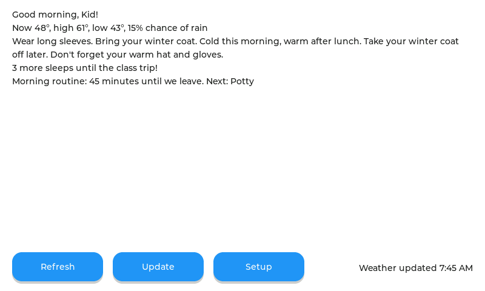

# How to make your own screens

The board's controller (everything in `main/`: WiFi, the weather, alerts and calendar downloads, settings, the setup hotspot, updates) doesn't know what the screens look like. It fills in one struct and hands it over. A new design is a new folder in `components/wb_ui/` that implements one small header. Nothing in `main/` changes.



That's the whole example design (`components/wb_ui/example/wb_ui_text.c`, about 180 lines): no artwork, LVGL's built-in font, and every feature still working: the weather, what to wear, alerts, the countdown, the routine, and the Refresh / Update / Setup buttons.

## The three parts

```
main/  (the controller)           components/wb_core/  (the logic)        components/wb_ui/  (the screens)
  net.c, settings.c, ota.c ...      wx.c       forecast                   wb_ui.h   the contract
          |                         alerts.c   kid words for alerts       2.0:      ui.c + ui_v2_extras.c
          |  fills wb_state_t       cal.c      calendar reader            classic:  classic/
          +-------------------->    outfit.c   2.0's what to wear         example:  example/
                wb_ui_update()      advice.c   classic's what to wear
          <--------------------     routine.c  morning / bedtime lists
                wb_action_t         countdown.c, dress.c, events.c ...
```

- **`components/wb_core/wb_state.h`**: everything the screens can show, in one struct (`wb_state_t`): the names, the pet, brightness, routine times, outfit cut-offs, the forecast, alerts, special events, dress-up days, calendar status, and the grown-up info (WiFi, town, version, status line).
- **`components/wb_ui/wb_ui.h`**: the contract. Seven functions and one callback:

| Function | When the controller calls it |
|---|---|
| `wb_ui_start(on_action, user, clock)` | Once, after the display is up. Keep the callback and the clock. |
| `wb_ui_update(&state)` | Whenever anything changed: new weather, a setting, a calendar read. Draw from it. |
| `wb_ui_show_boot(msg)` | Starting up (`NULL`: your own words) |
| `wb_ui_show_setup(ap, password, url)` | The setup hotspot is on; tell a grown-up how to join it |
| `wb_ui_show_connecting(ssid)` | Joining WiFi |
| `wb_ui_show_wifi_error(ssid, detail)` | WiFi trouble (`detail` may be `NULL`) |

  The next `wb_ui_update()` after a status screen means "back to normal".

  Taps go back as `on_action(act, value, user)`:

| Action | Value | What the controller does |
|---|---|---|
| `WB_ACT_REFRESH` | | Downloads the weather, alerts and calendar now |
| `WB_ACT_UPDATE` | | Checks for a firmware update now |
| `WB_ACT_SETUP` | | Starts the setup hotspot (WiFi, town, names...) |
| `WB_ACT_SET_PET` | a `wb_pet_t` | Saves the pet choice, then sends a new state |
| `WB_ACT_SET_BRIGHTNESS` | 30..100 | Saves it (dimming is the screens' job; the backlight is on/off only) |

- **`components/wb_core/`**: plain C (no LVGL, no ESP-IDF) that answers the questions a screen asks. Use it rather than re-deriving the rules, so every design agrees:

| Ask | Call |
|---|---|
| What should she wear, and what's the weather block? | `outfit_make(&st->wx, &now, day_offset, &opts, &out)` (2.0's rules: `out.advice`, `out.tile_kind[]`, `out.t_now`, `hi`, `lo`...) or `advice.c` (classic's) |
| Is there a countdown? | `wb_countdown_text(st->events, st->nevents, today, short_form, buf, size)` |
| What's on the routine, and how long is left? | `wb_routine_view(&r, &now, &view)`: the steps, their words, ticks, the next one, the title, "35 minutes until we leave", the bar's fill and colour; `wb_routine_toggle()` on a tap |
| Dress or jeans today? | `wb_dress_on()`, `wb_dress_toggle()` |
| Which calendar events are today? | `cal_count()` / `cal_get(i)` |
| Tonight's moon? | `wx_moon_phase()` |
| What to call an alert? | `st->alerts.a[0].title` and `.kid` (calm words), `.event` (the official name, for grown-ups) |

## Making one

1. Copy `components/wb_ui/example/` to a new folder and rename the file.
2. In `components/wb_ui/CMakeLists.txt`, add a branch that sets `WB_UI_SRCS` to your files, the way the example's does. Leave `WB_SHARED_SRCS` empty if you implement `wb_ui.h` yourself, like the example. Add your artwork's `.c` files there too.
3. Select it in `components/wb_ui/ui_select.h` (the example uses `#define WB_UI_EXAMPLE 1`; add your own switch the same way).
4. Try it on the PC first: give `sim/Makefile` a `UI=yours` branch like `UI=example`'s, and a `sim/yours/sim_main.c` (copy `sim/example/sim_main.c`: it fills a `wb_state_t` from a sample forecast and saves PNGs). Then `cd sim && make UI=yours shots`.
5. `idf.py build`, flash, or publish it as an update (see the README). Settings carry over between designs.

Rules of the road:

- Call LVGL only from `wb_ui_*` and your own LVGL callbacks and timers. The controller holds the LVGL lock while it calls you.
- Copy what you need out of the state. The controller reuses it after the call.
- The clock callback gives the local time (`false` until it's set). Use it rather than the forecast's time, so the screens keep up while offline. Add an LVGL timer if something counts down (the example redraws every 30 seconds).
- Screen-only state (ticks on the routine, the dress-up taps, which page is showing) belongs to the screens. Nothing needs saving: the controller saves settings, and only through actions.
- The screen is 800 x 480 (`UI_W`, `UI_H` in `ui.h`).
- Keep names out of the code. They come from the setup page through `st->names` and `st->pet_name`.

## Or reuse a design's pieces

The 2.0 and classic designs don't implement `wb_ui.h` themselves. They implement the older, finer-grained setters in `components/wb_ui/ui.h` (`ui_show_weather`, `ui_set_names`, `ui_set_alerts`...), and the shared adapter `components/wb_ui/wb_ui.c` turns each state into the setter calls whose parts changed. A design that starts from one of them can keep that split. A new one is simpler written straight against `wb_ui.h`.

## Tests

`cd sim && make test` runs the core's own tests: the calendar reader (`test_cal.c`), update manifests (`test_update.c`), the countdown, dress-up days and routine (`test_core.c`), and every web request's size (`test_request.c`). A change to `wb_core` should come with a test there. A change to a design should come with a screenshot (`make UI=... shots`).
